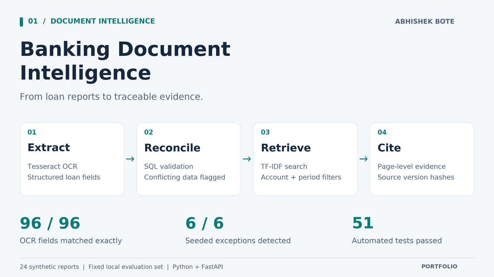
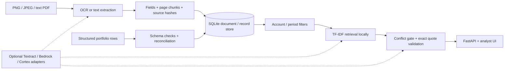

# Banking Document Intelligence



Built by [Abhishek Bote](https://github.com/InfinityAbhi).

A working local portfolio application for reconciling loan-document figures with structured portfolio records and retrieving source evidence. All reports, accounts, and amounts are synthetic.

The problem: an analyst should not copy a principal balance into a review packet without knowing which report it came from or whether it matches the portfolio record. This application ingests a report, extracts its fields, checks structured records, and supplies page-level quotations. Conflicting records trigger a review response rather than an answer.

## Run locally

Python 3.12 and Tesseract must be installed, with `tesseract` available on your PATH. No cloud credentials are required for local mode. Run from this project directory:

```sh
python3 -m venv .venv
.venv/bin/python -m pip install -r requirements.txt
.venv/bin/python scripts/evaluate.py --db .runtime/demo.sqlite
BANKDOCS_DB=.runtime/demo.sqlite .venv/bin/python -m uvicorn bankdocs.api:create_app --factory --host 127.0.0.1 --port 8768 --log-config deploy/logging.json
```

Open `http://127.0.0.1:8768`. The local demonstration key is `synthetic-local-demo`. API documentation is at `/docs`. The first evaluation run requires a new database path and refuses to overwrite an existing database. Runtime databases are created locally and are not committed.

Try these questions:

- `What is the outstanding principal for ACCT-002 in 2026-Q2?` returns the source quotation, page, and SHA-256 hash.
- `What is the principal for ACCT-001 in 2026-Q1?` blocks the answer because the structured record intentionally differs by USD 100.
- `What is the principal for ACCT-999?` returns no evidence.

Use the upload panel for a PNG/JPEG or a text PDF. The local workflow supports images up to 5 MB / 20 megapixels and unencrypted text PDFs up to 10 pages. Scanned PDFs must be exported to PNG/JPEG first. Structured rows can be supplied to `POST /api/records` through the API documentation. Include the account and period in the document title for metadata-filtered searches.

## Measured results

The saved benchmark is in [evaluation/results.json](evaluation/results.json). Test results are in [evaluation/tests.xml](evaluation/tests.xml).

| Measurement | Observed result | Interpretation |
|---|---:|---|
| Clean synthetic report images | 24 | 12 accounts, two reporting periods |
| OCR field exact matches | 96 / 96 | Account, period, currency, principal only |
| Portfolio rows processed | 29 | 24 accepted, 5 rejected |
| Deliberately seeded issues surfaced | 6 / 6 | 5 invalid rows and 1 document/record mismatch |
| Reconciled records | 23 | The mismatched accepted row remains quarantined |
| Correct report at rank 1 | 48 / 48 queries | Questions include exact account and period filters |
| Expected value in top 3 excerpts | 48 / 48 queries | Presence of the expected number, not an LLM correctness score |
| Automated unit/API/contract/configuration tests | 51 passed | No live cloud calls |

These are small, controlled fixture results. The images share a clean layout and the queries explicitly identify an account and period. They do not establish general OCR accuracy, semantic search quality, cloud performance, customer savings, or production readiness. The project has not processed real bank data. No lending or credit decisions are made.

## Architecture



The local path uses actual Tesseract OCR, Python, SQL/SQLite, 65-word chunks with 12-word overlap, TF-IDF vectors, cosine ranking, and exact excerpts. It does not run a local LLM. SHA-256 identifiers preserve source and corpus versions. Ingestion is idempotent; changing a document requires a new ID. Records are validated independently so an invalid row does not reject the whole batch.

Cloud adapters are opt-in. Bedrock or Cortex can select exact evidence from retrieved context; model responses must follow a strict JSON schema and quote a retrieved chunk verbatim. Cortex can supply semantic embeddings. Quote validation prevents fabricated citations and altered quotations; it does not prove relevance, factual truth, or immunity to every prompt injection. The prompt treats retrieved text as untrusted data.

## What was and was not validated

| Component | Implementation and validation |
|---|---|
| FastAPI, SQLite, OCR, UI, local retrieval | Executed locally, automated tests, browser checks |
| AWS Textract | Real boto3 request adapter; request/response contract tested with `botocore.stub.Stubber`; not executed in AWS |
| AWS Bedrock | Converse adapter; SDK request contract and incomplete-response handling tested with Stubber; not executed in AWS |
| Snowflake Cortex | `AI_EMBED` and `AI_COMPLETE` adapter with bound SQL parameters; fake-cursor tests check binding and connection cleanup; no live Snowflake SQL execution |
| Docker | Non-root container recipe authored; image not built because Docker is unavailable on this machine |
| ECS Fargate | Task definition checked against the AWS SDK input schema; no task registered or deployed |

## Cloud configuration

Local mode is the default and does not create any cloud clients. To try cloud mode after reviewing cost, permissions, and approved data handling:

1. Install `requirements-cloud.txt` if using Cortex. This optional connector dependency was not installed or tested during the local run.
2. Set `BANKDOCS_MODE=cloud`, an explicit `BANKDOCS_API_KEY` of at least 24 characters, and `AWS_REGION`.
3. Supply AWS credentials through the normal approved AWS credential chain or an ECS task role. The application uses Textract for PNG/JPEG input in cloud mode. Select `GENERATOR_BACKEND=bedrock` and set an available `BEDROCK_MODEL_ID`, or use `GENERATOR_BACKEND=cortex` and set `CORTEX_MODEL_ID`.
4. For Cortex, set `SNOWFLAKE_ACCOUNT`, `SNOWFLAKE_USER`, `SNOWFLAKE_PRIVATE_KEY_FILE`, `SNOWFLAKE_ROLE`, and `SNOWFLAKE_WAREHOUSE`. The connection uses a key file, not a password embedded in source. Set `RETRIEVER_BACKEND=cortex` to use embeddings; otherwise retrieval stays lexical. The default embedding model is `snowflake-arctic-embed-m`.
5. Replace every `REPLACE_*` value and example AWS account in `deploy/ecs-task-definition.json`. Configure least-privilege roles, a real image, Secrets Manager, log group, private networking and authenticated TLS ingress. The template starts in local mode; set cloud variables deliberately. ECS uses a Docker `VOLUME /tmp` with matching mount path for writable scratch space under a read-only root filesystem.

The ECS template is for one disposable prototype task. SQLite and its uploaded data are ephemeral, and the service is not designed for multiple replicas. A production design needs durable object storage and a managed database/vector index, migrations, retries/queues, SSO with document-level entitlements, rate limits, tenant isolation, encryption/retention policies, cloud monitoring and load/security testing. None of these enterprise controls is implied by the demo API key. Cortex currently embeds at request time with a 200-input cap; production ingestion should precompute and persist embeddings to control cost and latency. Exception remediation and approval are outside the current UI: flags are shown and answers blocked, but records are not automatically corrected or cleared.

## Verification and project files

```sh
.venv/bin/python -m pytest -q --junitxml=evaluation/tests.xml
.venv/bin/python scripts/evaluate.py --db .runtime/another-evaluation.sqlite
```

- `bankdocs/core.py`: OCR, chunking, immutable-source ingestion, SQL validation, retrieval, source-quote checks.
- `bankdocs/cloud.py`: Textract, Bedrock, and Cortex adapters and explicit cloud configuration.
- `bankdocs/api.py`: authenticated application endpoints, upload bounds, request IDs, sanitized request metrics, content-security headers.
- `bankdocs/static/`: analyst interface with safe text rendering.
- `data/`: generated PNG reports, portfolio CSV, ground-truth fields and fixed query set.
- `scripts/generate_fixtures.py`: reproducible fixture generator. The delivered images are fixed; regeneration can differ with system fonts.
- `scripts/evaluate.py`: actual OCR and HTTP-handler benchmark through FastAPI TestClient.
- `tests/test_workbench.py`: failure cases, lineage, authentication, model-output validation, cloud contracts, and ECS schema.
- `evaluation/workbench.jpg`: verified browser screenshot.
- `requirements-lock.txt`: exact installed local environment.

One non-failing dependency warning occurred: the installed Starlette version deprecates its httpx-backed TestClient. The tests passed; migrating the test harness to its replacement is a maintenance task.

## Primary technical references

- [AWS Textract detect_document_text](https://docs.aws.amazon.com/boto3/latest/reference/services/textract/client/detect_document_text.html)
- [AWS Bedrock Converse](https://docs.aws.amazon.com/boto3/latest/reference/services/bedrock-runtime/client/converse.html)
- [Snowflake AI_EMBED](https://docs.snowflake.com/en/sql-reference/functions/ai_embed)
- [Snowflake AI_COMPLETE](https://docs.snowflake.com/en/sql-reference/functions/ai_complete-single-string)
- [ECS task definition parameters](https://docs.aws.amazon.com/AmazonECS/latest/developerguide/task_definition_parameters.html)
- [ECS bind mounts and Docker VOLUME permissions](https://docs.aws.amazon.com/AmazonECS/latest/developerguide/bind-mounts.html)

Synthetic fixtures were generated for this portfolio project. No proprietary bank documents or copied external dataset are included.
